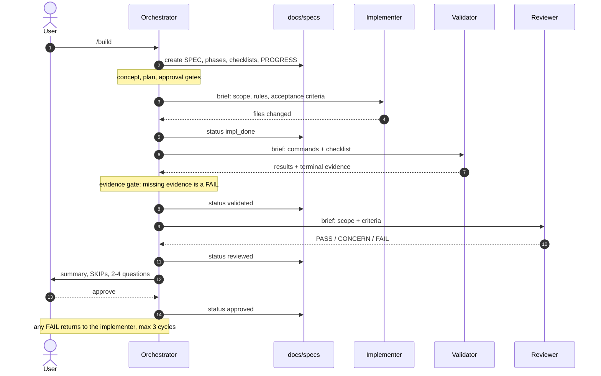
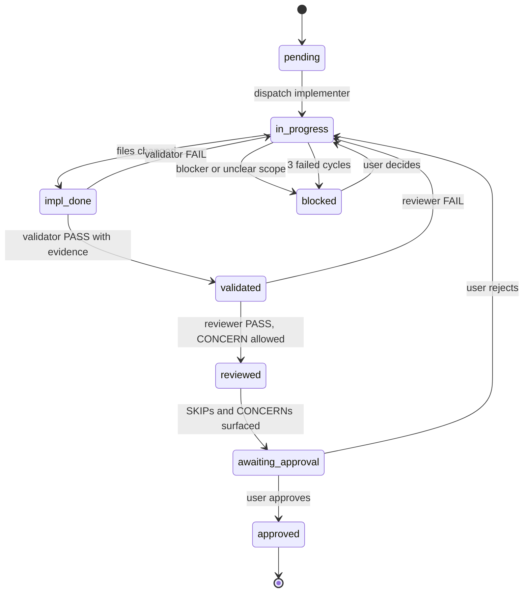

# WorkNest Orchestration

How WorkNest changes move from a request to an approved result. This page is a map, not the
executable rules: the source of truth is `.opencode/skills/orchestration/SKILL.md`. If a diagram
here disagrees with the skill, the skill wins.

## Roles

| Role         | Agent          | Job                                                   |
| ------------ | -------------- | ----------------------------------------------------- |
| Orchestrator | `orchestrator` | Plan, dispatch, track status, enforce gates, teach    |
| Implementer  | `implementer`  | Write the scoped code, tests, and docs                |
| Validator    | `validator`    | Run checks and report terminal evidence               |
| Reviewer     | `reviewer`     | Judge correctness, security, contracts, tests, design |

`explore` is used for reconnaissance and `general` for one-off research. Neither replaces a role in
the loop.

## End-to-end flow

`/plan` is a separate read-only pass; the sequence below starts at `/build`.



For terminals and editors that do not render Mermaid:

```text
/plan  ──▶  plan agent (read-only)  ──▶  agreed plan
                                              │
/build ──▶  ORCHESTRATOR  ──▶  docs/specs/SPEC-NNN-slug/
                │
                ├─ 1. implementer  ──▶ files changed          ──▶ impl_done
                ├─ 2. validator    ──▶ evidence + exit code   ──▶ validated
                └─ 3. reviewer     ──▶ PASS / CONCERN / FAIL  ──▶ reviewed
                                              │
                                              ▼
                                   awaiting_approval ──▶ approved

Any FAIL  ──▶  status in_progress, cycle + 1, re-dispatch implementer
3 failed cycles  ──▶  blocked
```

## Phase states



A **cycle** is one implement → validate → review pass that ends in FAIL. The counter resets to
`0/3` on approval and when the user redirects the implementation. A review FAIL re-runs validation
before the next review.

## Permissions

| Component      | Type     | Edits                | Shell                          | Can launch                                         |
| -------------- | -------- | -------------------- | ------------------------------ | -------------------------------------------------- |
| `orchestrator` | primary  | `docs/specs/**` only | `ask` + verification allowlist | implementer, validator, reviewer, explore, general |
| `implementer`  | subagent | code, tests, docs    | git read-only                  | —                                                  |
| `validator`    | subagent | none                 | test/lint/build allowlist      | —                                                  |
| `reviewer`     | subagent | none                 | git read-only                  | —                                                  |
| `explore`      | subagent | none                 | allowed, instructed read-only  | —                                                  |
| `general`      | subagent | yes                  | yes                            | —                                                  |

The separation is enforced by tool permissions, not by instructions. The validator and reviewer
have no write tool at all; the orchestrator has no write tool outside `docs/specs/`.

This table mirrors the agent frontmatter, which is the copy the harness enforces. If they disagree,
the frontmatter wins.

## Entry points

| Command     | Runs as                         | Purpose                             |
| ----------- | ------------------------------- | ----------------------------------- |
| `/plan`     | `plan` agent, current session   | Explore and agree a plan; no edits  |
| `/build`    | `orchestrator`, current session | Create the spec and run the loop    |
| `/validate` | `validator`, child session      | Run checks and return evidence      |
| `/review`   | `reviewer`, child session       | Review changes and return a verdict |

## File map

```text
.opencode/
  agents/
    orchestrator.md      primary; plans, dispatches, tracks, teaches
    implementer.md       subagent; writes code, tests, docs
    validator.md         subagent; runs checks, cannot edit
    reviewer.md          subagent; reviews, cannot edit
  commands/
    plan.md              /plan
    build.md             /build
    validate.md          /validate
    review.md            /review
  skills/
    orchestration/
      SKILL.md           workflow source of truth

docs/
  orchestration.md       this document
  specs/
    README.md
    _templates/
      SPEC.md
      PHASE.md
      CHECKLIST.md
      PROGRESS.md
    SPEC-NNN-slug/
      SPEC.md
      phases/phase-N-name.md
      checklists/phase-N-checklist.md
      PROGRESS.md
```

## Gates the diagrams do not show

- **Approval gates** — stop for the user before a dependency, migration, destructive command,
  secret, scope change, or a phase with outstanding SKIPs.
- **Evidence gate** — every command in the brief needs terminal output and an exit code. A PASS or
  SKIP without evidence is a FAIL.
- **Cycle limit** — three failed implement → validate → review cycles set the phase to `blocked`.
- **Docs duty** — behavior, architecture, or API contract changes update the relevant doc or add an
  ADR (`AGENTS.md §10`).
